<picture>
  <source media="(prefers-color-scheme: dark)" srcset=".github/assets/header-dunkel.svg">
  
</picture>

     

<h3 align="center">AI for the work a business actually does.</h3>

Applied AI for businesses and professionals, sorted by the function it serves: science and monitoring, finance and trading, marketing and sales, office and data, careers and education, and industries like health and law. Curated by Wellux, which brings AI to small and mid-sized companies. Ready tools sit next to research code, courses and early projects, so test each pick before it touches real work.

<!-- onboarding:start -->
### In 3 Minuten startklar

<picture>
  <source media="(prefers-color-scheme: dark)" srcset=".github/assets/onboarding-dunkel.svg">
  
</picture>

1. **Start here.** Oben unter [Start here](#start-here) stehen 4 Picks, einer je Rolle. Fang mit dem an, der zu deiner Lücke passt.
2. **Rubrik.** Unter [Contents](#contents) die Rubrik wählen: 213 Repos, jedes genau einmal einsortiert, nach der Aufgabe, die es erledigt.
3. **Ausprobieren.** Den Pick öffnen und seine Install-Zeile ausführen; die Sterne zeigen, wie viele ihn schon nutzen.
4. **Dranbleiben.** Dieser Liste einen Stern geben: neue Picks erscheinen in deinem GitHub-Feed.

**Was du davon hast**

- 213 Repos rund um AI at Work, nach Aufgabe sortiert, statt tagelang selbst zu suchen.
- Jeder Pick sagt in einem Satz, wofür er gut ist.
- Aufgenommen wird nur, was öffentlich ist, eine Lizenz hat und heute läuft.

**Nächster Schritt:** Fehlt ein Repo? Über [CONTRIBUTING.md](CONTRIBUTING.md) vorschlagen, ein Satz zur Aufgabe genügt; mehr Listen auf [github.com/Wellux](https://github.com/Wellux).
<!-- onboarding:end -->

## Start here

No time for 213 repos? Start with these 4, one per role. Add the rest when you feel the gap.

| Role | Pick | Why |
|:--|:--|:--|
| **Watch** | [trendFinder](https://github.com/ericciarla/trendFinder) `★ 4.1k` | Watches the X accounts and websites you pick and pings Slack or Discord when a trend breaks |
| **Analyze** | [WrenAI](https://github.com/Canner/WrenAI) `★ 18k` | Answers plain-language data questions with governed SQL and charts |
| **Grow** | [marketingskills](https://github.com/coreyhaines31/marketingskills) `★ 57.1k` | Gives coding agents skills for CRO, copy, SEO and growth |
| **Deliver** | [OfficeCLI](https://github.com/iOfficeAI/OfficeCLI) `★ 32.7k` | Lets agents read, edit and automate Word, Excel and PowerPoint files |

<picture>
  <source media="(prefers-color-scheme: dark)" srcset=".github/assets/map-dunkel.svg">
  
</picture>

## Contents

- [Research and monitoring](#research-and-monitoring) · 32 [Science and academic skills](#science-and-academic-skills) · [News and trend monitoring](#news-and-trend-monitoring) · [Simulation and forecasting](#simulation-and-forecasting)
- [Finance and trading](#finance-and-trading) · 55 [LLM trading and investing agents](#llm-trading-and-investing-agents) · [Machine learning for markets](#machine-learning-for-markets) · [Finance skills and data for agents](#finance-skills-and-data-for-agents)
- [Marketing and growth](#marketing-and-growth) · 55 [SEO and AI search](#seo-and-ai-search) · [Content and social](#content-and-social) · [Marketing packs, ads and sales](#marketing-packs-ads-and-sales)
- [Office, documents and data](#office-documents-and-data) · 32 [AI office suites and inbox agents](#ai-office-suites-and-inbox-agents) · [Talk to your data](#talk-to-your-data) · [AI for IT and ops](#ai-for-it-and-ops)
- [Careers and education](#careers-and-education) · 24 [Jobs and hiring](#jobs-and-hiring) · [Tutors and classrooms](#tutors-and-classrooms) · [Founders and strategy](#founders-and-strategy)
- [Industries](#industries) · 15 [Health and law](#health-and-law) · [Commerce, real estate and support](#commerce-real-estate-and-support)

## Research and monitoring

Find, read and watch so you do not have to.

### Science and academic skills

- **[scientific-agent-skills](https://github.com/K-Dense-AI/scientific-agent-skills)** `★ 55.1k` · **Top pick.** 177 agent skills and 100+ databases for biology, chemistry, medicine and drug discovery.
- **[academic-research-skills](https://github.com/Imbad0202/academic-research-skills)** `★ 54.4k` · Claude Code skills that take academic work from research to writing, review and revision.
- **[AI-Research-SKILLs](https://github.com/Orchestra-Research/AI-Research-SKILLs)** `★ 14.1k` · Open-source library of skills for AI research and engineering work.
- **[academic-research-skills-codex](https://github.com/Imbad0202/academic-research-skills-codex)** `★ 13.7k` · Codex-native skills for human-in-the-loop academic research workflows.
- **[paper-qa](https://github.com/Future-House/paper-qa)** `★ 9.5k` · High-accuracy RAG that answers questions from scientific documents with citations.
- **[Research-Paper-Writing-Skills](https://github.com/Master-cai/Research-Paper-Writing-Skills)** `★ 7.9k` · Skill package for writing ML, computer vision and NLP papers with coding agents.
- **[open-science](https://github.com/aipoch/open-science)** `★ 5.4k` · Local-first, model-agnostic desktop workbench for scientific research and agent workflows.
- **[Auto-Empirical-Research-Skills](https://github.com/brycewang-stanford/Auto-Empirical-Research-Skills)** `★ 4.8k` · Curated collection of 23,000+ agent skills for empirical research in eight social sciences.
- **[openscience](https://github.com/synthetic-sciences/openscience)** `★ 4.3k` · Open-source AI workbench for scientific research.
- **[openfold](https://github.com/aqlaboratory/openfold)** `★ 3.4k` · Trainable, memory-efficient PyTorch reproduction of AlphaFold 2 for protein structure.
- **[science-skills](https://github.com/google-deepmind/science-skills)** `★ 3.4k` · Google DeepMind skills for agentic science that draw on AlphaGenome, UniProt and 30+ databases.
- **[scipilot-figure-skill](https://github.com/Haojae/scipilot-figure-skill)** `★ 2.7k` · Claude Code skill that makes publication-grade figures for scientific papers.
- **[papersgpt-for-zotero](https://github.com/papersgpt/papersgpt-for-zotero)** `★ 2.7k` · Zotero plugin to chat with PDFs and search your whole library using 30+ LLMs.
- **[medical-research-skills](https://github.com/aipoch/medical-research-skills)** `★ 2k` · Hundreds of agent skills for medical research, from protocol design to data analysis.
- **[evil-read-arxiv](https://github.com/juliye2025/evil-read-arxiv)** `★ 1.8k` · Claude Code and Obsidian workflow for reading arXiv papers quickly.
- **[DeepPaperNote](https://github.com/917Dhj/DeepPaperNote)** `★ 1.3k` · Agent skill that deep-reads a single paper and writes Obsidian-style research notes.
- **[humanities-thesis-skill](https://github.com/ganzhi-black/humanities-thesis-skill)** `★ 792` · Skill for writing humanities theses from topic selection to publication.
- **[research-units-pipeline-skills](https://github.com/WILLOSCAR/research-units-pipeline-skills)** `★ 517` · Research pipelines of skills that declare inputs, outputs, acceptance criteria and guardrails.
- **[citation-assistant](https://github.com/ZhangNy301/citation-assistant)** `★ 237` · Claude Code skill that automates academic citation workflows with the Semantic Scholar API.
- **[Caliper](https://github.com/AIScientists-Dev/Caliper)** `★ 197` · Tool-using AI research analyst for science that is calibrated and risk-controlled.

### News and trend monitoring

- **[TrendRadar](https://github.com/sansan0/TrendRadar)** `★ 63.3k` · **Top pick.** Trend monitor for 11 Chinese hot lists and your RSS feeds, with keyword filters and AI briefs.
- **[worldmonitor](https://github.com/koala73/worldmonitor)** `★ 89.7k` · Real-time global news dashboard with AI-powered aggregation.
- **[Crucix](https://github.com/calesthio/Crucix)** `★ 12.2k` · Personal intelligence agent that watches the world through many data sources.
- **[AIHOT](https://github.com/KKKKhazix/AIHOT)** `★ 8.8k` · Website framework that finds trending topics and writes a daily digest from your own sources.
- **[trendFinder](https://github.com/ericciarla/trendFinder)** `★ 4.1k` · AI tool that tracks trending topics on social media and the web.
- **[clawfeed](https://github.com/kevinho/clawfeed)** `★ 2.4k` · AI news digest with structured summaries from Twitter and RSS feeds, plus a web dashboard.
- **[gpt-newspaper](https://github.com/rotemweiss57/gpt-newspaper)** `★ 1.5k` · GPT-based autonomous agent that creates personalized newspapers tailored to user preferences.
- **[auto-news](https://github.com/finaldie/auto-news)** `★ 910` · Personal news aggregator that combines multiple sources with an LLM (ChatGPT, Gemini, Ollama).
- **[webdog](https://github.com/context-dot-dev/webdog)** `★ 113` · AI-native website change monitoring.

### Simulation and forecasting

- **[MiroFish](https://github.com/666ghj/MiroFish)** `★ 82.5k` · **Top pick.** Swarm-intelligence engine of LLM agents that simulates scenarios to forecast outcomes.
- **[MiroFish-Offline](https://github.com/nikmcfly/MiroFish-Offline)** `★ 2.7k` · English fork of MiroFish: offline multi-agent simulation and prediction on Neo4j and Ollama.
- **[mirofish-cli](https://github.com/SCTY-Inc/mirofish-cli)** `★ 323` · Command-line multi-agent prediction engine that simulates scenarios in a digital sandbox.

<a href="#contents">back to contents</a>

## Finance and trading

Markets, analyzed by agents and machine learning.

### LLM trading and investing agents

- **[TradingAgents](https://github.com/TauricResearch/TradingAgents)** `★ 117.9k` · **Top pick.** Multi-agent LLM framework for financial trading.
- **[daily_stock_analysis](https://github.com/ZhuLinsen/daily_stock_analysis)** `★ 67.2k` · LLM-driven multi-market stock analysis with live quotes, news, a decision dashboard and push alerts.
- **[Vibe-Trading](https://github.com/HKUDS/Vibe-Trading)** `★ 37k` · Personal trading agent with multi-agent analysis, backtesting and MCP support.
- **[dexter](https://github.com/virattt/dexter)** `★ 27.7k` · Autonomous agent that runs deep financial research.
- **[FinGPT](https://github.com/AI4Finance-Foundation/FinGPT)** `★ 21.5k` · Open-source financial large language models, with trained weights released on Hugging Face.
- **[QuantDinger](https://github.com/OpenByteInc/QuantDinger)** `★ 13.3k` · Open-source AI trading OS for strategy research, backtesting and paper or live trading.
- **[OpenAlice](https://github.com/TraderAlice/OpenAlice)** `★ 7.4k` · AI trading agent covering equities, crypto, commodities, forex and macro.
- **[AutoHedge](https://github.com/The-Swarm-Corporation/AutoHedge)** `★ 6.6k` · Swarm of AI agents that automates market analysis, risk management and trade execution.
- **[jev-trader](https://github.com/jarrodwatts/jev-trader)** `★ 3.1k` · Bot that makes one AI trade decision per Monad block with Jev on the Kuru MON-USDC market.
- **[QuantHarness](https://github.com/Y-Research-SBU/QuantHarness)** `★ 2.9k` · Official code for QuantHarness, price-driven multi-agent LLMs for high-frequency trading.
- **[ai-market-maker](https://github.com/olaxbt/ai-market-maker)** `★ 2.1k` · Agentic AI hedge fund system for crypto trading using multiple agents.
- **[ai-financial-agent](https://github.com/virattt/ai-financial-agent)** `★ 2k` · Financial agent for investment research.
- **[QuantaAlpha](https://github.com/QuantaAlpha/QuantaAlpha)** `★ 1.6k` · LLM framework that mines and evolves quantitative alpha factors with evolutionary strategies.
- **[QuantGPT](https://github.com/Miasyster/QuantGPT)** `★ 496` · LLM agent that designs, backtests and submits alpha factors to WorldQuant BRAIN.
- **[vibe-investing](https://github.com/gameworkerkim/vibe-investing)** `★ 352` · LLM quant trading tools and multi-agent backtesting for US stocks and crypto.
- **[FriesTrader](https://github.com/YizhiSong/FriesTrader)** `★ 284` · Fully automated AI trading bot that places real orders through Robinhood's Agentic Trading.
- **[model-trader](https://github.com/tonbistudio/model-trader)** `★ 125` · Framework that uses Claude to turn a trader's content into a screener and paper trader.
- **[fingen](https://github.com/sullyo/fingen)** `★ 108` · Finance agent that answers with generative UI.

### Machine learning for markets

- **[qlib](https://github.com/microsoft/qlib)** `★ 49.8k` · **Top pick.** AI-oriented quant investment platform that applies machine learning to quant research.
- **[machine-learning-for-trading](https://github.com/stefan-jansen/machine-learning-for-trading)** `★ 21.6k` · Code for the book Machine Learning for Trading, from data sourcing to live execution.
- **[Qbot](https://github.com/UFund-Me/Qbot)** `★ 18.7k` · Locally deployed AI quant trading bot and investment research platform.
- **[tensortrade](https://github.com/tensortrade-org/tensortrade)** `★ 7.3k` · Reinforcement learning framework for training, evaluating and deploying trading agents.
- **[ai_quant_trade](https://github.com/charliedream1/ai_quant_trade)** `★ 6.7k` · Stock trading platform for learning, simulation and live trading, with LLMs and factor mining.
- **[Awesome-Quant-Machine-Learning-Trading](https://github.com/grananqvist/Awesome-Quant-Machine-Learning-Trading)** `★ 4.1k` · Curated list of quant and algorithmic trading resources with an emphasis on machine learning.
- **[pybroker](https://github.com/edtechre/pybroker)** `★ 3.7k` · Python algorithmic trading and backtesting framework built around machine learning.
- **[QuantMuse](https://github.com/0xemmkty/QuantMuse)** `★ 3k` · Quant trading system with AI-powered analysis, real-time data processing and risk management.
- **[stock-rnn](https://github.com/lilianweng/stock-rnn)** `★ 2k` · Stock price prediction with a multilayer LSTM RNN and optional multi-stock embeddings.
- **[intelligent-trading-bot](https://github.com/asavinov/intelligent-trading-bot)** `★ 1.9k` · Trading bot that generates signals and trades using machine learning and feature engineering.
- **[surpriver](https://github.com/tradytics/surpriver)** `★ 1.9k` · Stock scanner that uses machine learning and anomaly detection to flag possible big movers.
- **[QuantMind](https://github.com/qusong0627/QuantMind)** `★ 1.8k` · AI-native multi-market quant trading platform built on Qlib, RD-Agent and machine-learning models.
- **[Deep-Trading](https://github.com/Rachnog/Deep-Trading)** `★ 1.5k` · Deep learning experiments for algorithmic trading.
- **[stock-analysis-engine](https://github.com/AlgoTraders/stock-analysis-engine)** `★ 1.2k` · Backtesting stack with live market data for building and tuning deep-learning trading algorithms.
- **[panda_quantflow](https://github.com/PandaAI-Tech/panda_quantflow)** `★ 1.1k` · Visual workflow platform for quant research with machine learning, factor analysis and backtests.
- **[ChatGPT_Trading_Bot](https://github.com/llSourcell/ChatGPT_Trading_Bot)** `★ 965` · Code for Siraj Raval's ChatGPT Trading Bot video, a FinRL reinforcement learning notebook.
- **[StockPredictionRNN](https://github.com/dzitkowskik/StockPredictionRNN)** `★ 829` · High-frequency trading price prediction using LSTM neural networks.
- **[artificial-intelligence-for-trading](https://github.com/udacity/artificial-intelligence-for-trading)** `★ 777` · Course content for Udacity's AI in Trading nanodegree.
- **[AI-for-Trading](https://github.com/purvasingh96/AI-for-Trading)** `★ 412` · Notes and Python projects on AI and finance, from alpha factors to backtesting.
- **[crypto-trading-ai-bot-basic](https://github.com/gdemos01/crypto-trading-ai-bot-basic)** `★ 302` · Basic crypto bot that trains a model to predict price moves and runs trading simulations.
- **[python-ai-trading-system](https://github.com/ruromgar/python-ai-trading-system)** `★ 251` · Code for a tutorial on building a fully automated AI-based trading system with Python.

### Finance skills and data for agents

- **[financial-services](https://github.com/anthropics/financial-services)** `★ 40.9k` · **Top pick.** Reference Claude agents, skills and connectors for banking, research, private equity and wealth.
- **[serenity-skill](https://github.com/muxuuu/serenity-skill)** `★ 4.1k` · Agent skill for researching stocks that sit at supply-chain bottlenecks.
- **[finance-skills](https://github.com/himself65/finance-skills)** `★ 3.5k` · Collection of skills for AI financial analysis.
- **[claude-trading-skills](https://github.com/tradermonty/claude-trading-skills)** `★ 3.4k` · Claude Code skills for equity investors and traders, from market analysis to screeners.
- **[Vibe-Research](https://github.com/simonlin1212/Vibe-Research)** `★ 3.4k` · Research workbench for A-share, US and HK stocks with daily reviews, backtests and reports.
- **[quant-mind](https://github.com/LLMQuant/quant-mind)** `★ 3.1k` · Agent-native framework for extracting and retrieving knowledge in quantitative finance.
- **[Awesome-finance-skills](https://github.com/RKiding/Awesome-finance-skills)** `★ 3.1k` · Collection of free, open-source agent skills for financial analysis.
- **[AlphaGBM/skills](https://github.com/AlphaGBM/skills)** `★ 2.8k` · 29 skills that bring real-time market data and research for stocks, options and commodities.
- **[quantskills](https://github.com/quantskills/quantskills)** `★ 2.4k` · Navigation hub for open-source quant skills and agents, from data and factors to backtesting.
- **[investorskills](https://github.com/questflowai/investorskills)** `★ 1.9k` · Open-source library that turns investing judgment into portable, structured skill formats.
- **[global-stock-data](https://github.com/simonlin1212/global-stock-data)** `★ 1.8k` · US and global market data kit for AI coding assistants, official sources first, no auth.
- **[binance-skills-hub](https://github.com/binance/binance-skills-hub)** `★ 1.1k` · Open skills marketplace giving AI agents native access to crypto.
- **[Day1Global-Skills](https://github.com/star23/Day1Global-Skills)** `★ 1.1k` · Finance skills covering US stocks, macro markets and crypto.
- **[vibe-astock](https://github.com/simonlin1212/vibe-astock)** `★ 885` · A-share short-term review workbench with AI recaps, weekly reports and a trade journal.
- **[trading-skills](https://github.com/roman-rr/trading-skills)** `★ 125` · Skills that give Claude Code, Codex and Cursor live crypto trading signals with reasoning.
- **[100x-credit-monitoring](https://github.com/100xopensource/100x-credit-monitoring)** `★ 24` · Claude Cowork plugin that turns borrower reports and loan files into a credit workbook and memo.

<a href="#contents">back to contents</a>

## Marketing and growth

Content, SEO and ads with agents that report back.

### SEO and AI search

- **[claude-seo](https://github.com/AgriciDaniel/claude-seo)** `★ 23.4k` · **Top pick.** Claude Code SEO skill with sub-skills and sub-agents for technical SEO, E-E-A-T, schema and GEO.
- **[open-seo](https://github.com/every-app/open-seo)** `★ 25.5k` · Open-source Semrush and Ahrefs alternative built for you and your AI agent, with MCP and skills.
- **[geo-seo-claude](https://github.com/zubair-trabzada/geo-seo-claude)** `★ 11.3k` · Claude Code skill for AI-search SEO: citability scoring, AI crawler checks and PDF reports.
- **[open-seo-mcp-skills](https://github.com/Ryze-AI-Adgent/open-seo-mcp-skills)** `★ 7.8k` · Free SEO MCP server and open-source SEO and GEO skills for keyword research, audits and backlinks.
- **[notfair-plugin](https://github.com/nowork-studio/notfair-plugin)** `★ 4.1k` · Open-source SEO, GEO and marketing skills for AI agents.
- **[GEOFlow](https://github.com/yaojingang/GEOFlow)** `★ 4k` · GEO content engineering and multi-site distribution platform with AI quality inspection.
- **[aso-skills](https://github.com/appeeky/aso-skills)** `★ 2.2k` · Agent skills for App Store optimization: keyword research, metadata and competitor analysis.
- **[gtm-engineer-skills](https://github.com/onvoyage-ai/gtm-engineer-skills)** `★ 1.3k` · Claude Code skill that improves a website's AEO and GEO scores.
- **[Seo-Promt-Master](https://github.com/umutxyp/Seo-Promt-Master)** `★ 564` · Prompt pack built from Google's SEO docs that audits every page of a site in your AI assistant.
- **[superseo-skills](https://github.com/inhouseseo/superseo-skills)** `★ 373` · 11 Claude skills for SEO, from page audits and linkbuilding to E-E-A-T audits.
- **[seo-os](https://github.com/AgriciDaniel/seo-os)** `★ 146` · Local-first operating system for an SEO agency, built on claude-seo specialists.
- **[ai-seo-audit](https://github.com/context-dot-dev/ai-seo-audit)** `★ 47` · Free auditor for AI SEO and GEO.
- **[legends-geogrid](https://github.com/avalonreset/legends-geogrid)** `★ 33` · Agent-first Google Maps rank checker, local rank tracker and Business Profile audit studio.
- **[RankWise](https://github.com/MADEVAL/RankWise)** `★ 30` · Prompt system that writes, rewrites and audits SEO content against 49 ranking factors.
- **[geo-skills](https://github.com/TheSmokeDev/geo-skills)** `★ 29` · 29 free GEO and AI-search agent skills plus a CLI for audits, citability and AI crawlers.
- **[local-seo-brain](https://github.com/AI-Marketing-Hub/local-seo-brain)** `★ 24` · Plain-language local SEO guide with an approval-first workflow for local businesses and agencies.
- **[google-seo](https://github.com/ceoguy/google-seo)** `★ 1` · Claude Code skill built on a local fork of Google Search Central's SEO documentation.

### Content and social

- **[social-media-agent](https://github.com/langchain-ai/social-media-agent)** `★ 3k` · **Top pick.** Agent that sources, curates and schedules social media posts with human-in-the-loop review.
- **[postiz-app](https://github.com/gitroomhq/postiz-app)** `★ 40k` · Social media platform for scheduling, automating and analyzing posts, also driven from AI agents.
- **[cheat-on-content](https://github.com/XBuilderLAB/cheat-on-content)** `★ 7.4k` · Skill workflow that turns every post into a calibrated experiment with scoring and prediction.
- **[RedInk](https://github.com/HisMax/RedInk)** `★ 5.7k` · Generator for Xiaohongshu image-and-text posts based on Nano Banana Pro.
- **[linkedin-skills](https://github.com/sergebulaev/linkedin-skills)** `★ 5.3k` · Twelve Claude Code and Codex skills for writing human-sounding LinkedIn posts and comments.
- **[social-media-research-skills](https://github.com/ScrapeCreators/social-media-research-skills)** `★ 5k` · Agent skills for social media research: outlier posts, comment mining and competitor teardowns.
- **[charlie947/social-media-skills](https://github.com/charlie947/social-media-skills)** `★ 4.4k` · 17 public skills for Codex and Claude covering LinkedIn writing, research, analytics and Reels.
- **[Easel](https://github.com/ZJU-REAL/Easel)** `★ 4.2k` · AI agent for social media that discovers trends, creates content and publishes it everywhere.
- **[claude-blog](https://github.com/AgriciDaniel/claude-blog)** `★ 2.6k` · Claude Code blog suite with 30 sub-skills and 5 agents, tuned for Google rankings and AI citations.
- **[newsjack](https://github.com/elvisun/newsjack)** `★ 1.7k` · PR skills for agents: spot news worth reacting to, then draft angles, pitches and fact checks.
- **[affiliate-skills](https://github.com/Affitor/affiliate-skills)** `★ 750` · 50 agent skills for affiliate marketing that research content, write posts and make infographics.
- **[blacktwist/social-media-skills](https://github.com/blacktwist/social-media-skills)** `★ 604` · Agent skills for social media content strategy, creation and analysis on text-first platforms.
- **[youtubepro](https://github.com/AgriciDaniel/youtubepro)** `★ 428` · Local-first YouTube workbench for research, AI insights, script writing and thumbnails.
- **[AutoGPT-Social](https://github.com/WillReynolds5/AutoGPT-Social)** `★ 343` · Autonomous Instagram bot that creates and optimizes posts to maximize engagement.
- **[youpac-ai](https://github.com/michaelshimeles/youpac-ai)** `★ 331` · AI assistant that turns uploaded videos into YouTube titles, descriptions, thumbnails and posts.
- **[head-of-content](https://github.com/bradautomates/head-of-content)** `★ 289` · Social media content research and marketing skills for Claude Code and Cowork.
- **[content-ideas](https://github.com/bradautomates/content-ideas)** `★ 147` · Tracks competitors on X, Instagram, TikTok and YouTube and turns top posts into content ideas.
- **[codex-marketing-skills](https://github.com/rbrown101010/codex-marketing-skills)** `★ 97` · Codex skills for creators and marketing work.
- **[AI-Content-Engine](https://github.com/vincentchan/AI-Content-Engine)** `★ 76` · Claude Code content engine for research, ideation and drafting, based on Dan Koe's framework.
- **[youtube-marketing-skills](https://github.com/adityaarsharma/youtube-marketing-skills)** `★ 72` · YouTube growth toolkit with 21 AI commands and a live channel MCP server.
- **[content-vault](https://github.com/timscheuerai/content-vault)** `★ 44` · 14 Claude Code skills and a Notion template that run a content engine for LinkedIn, X and YouTube.
- **[10x-Content-Expert](https://github.com/OpenAnalystInc/10x-Content-Expert)** `★ 21` · Claude Code plugin with skills for emails, social posts, presentations and blogs.
- **[x-algorithm-skill](https://github.com/ceoguy/x-algorithm-skill)** `★ 1` · Claude skill for writing X posts engineered against the open-source For-You ranker.

### Marketing packs, ads and sales

- **[marketingskills](https://github.com/coreyhaines31/marketingskills)** `★ 57.1k` · **Top pick.** Marketing skills for coding agents: CRO, copywriting, SEO, analytics and growth engineering.
- **[claude-ads](https://github.com/AgriciDaniel/claude-ads)** `★ 10.5k` · Claude Code skill for source-grounded paid-media audits and reports across 12 ad platforms.
- **[marketing-skills](https://github.com/irinabuht12-oss/marketing-skills)** `★ 6.1k` · 49 free marketing skills for Claude covering ads, SEO and AI visibility.
- **[ai-marketing-skills](https://github.com/ericosiu/ai-marketing-skills)** `★ 3.7k` · Open-source skills for growth experiments, sales pipeline, content ops, outbound and SEO.
- **[OpenOutreach](https://github.com/eracle/OpenOutreach)** `★ 3.4k` · Self-hosted AI agent that finds B2B leads for your product, explains each fit and emails them.
- **[aaron-marketing-skills](https://github.com/aaron-he-zhu/aaron-marketing-skills)** `★ 3k` · 120 marketing skills for SEO, social, email, paid and launch work, as a plugin or an 8-bot team.
- **[ai-marketing-claude](https://github.com/zubair-trabzada/ai-marketing-claude)** `★ 2.8k` · Marketing skill suite for Claude Code covering site audits, copy, email, ads and client reports.
- **[SalesGPT](https://github.com/filip-michalsky/SalesGPT)** `★ 2.8k` · Context-aware AI sales agent that automates sales outreach.
- **[arcads-claude-code](https://github.com/krusemediallc/arcads-claude-code)** `★ 1.6k` · Agent skills, a prompt library and a Cursor or Claude workspace for the Arcads video-ad API.
- **[goose-skills](https://github.com/gooseworks-ai/goose-skills)** `★ 1.3k` · Growth and go-to-market skills and data APIs for ads, social, content, lead gen and SEO.
- **[advertising-skills](https://github.com/realkimbarrett/advertising-skills)** `★ 766` · Skills for OpenClaw, Claude Code and other agents on direct response, paid ads and funnels.
- **[sales-outreach-automation-langgraph](https://github.com/kaymen99/sales-outreach-automation-langgraph)** `★ 405` · LangGraph agents that research, qualify and contact sales leads with personalized messages.
- **[ads-skills](https://github.com/ivangfalco/ads-skills)** `★ 286` · Claude Code skills for LinkedIn, Meta and Google Ads with strategy files and API scripts.
- **[gtm](https://github.com/gtm-skills/gtm)** `★ 183` · Go-to-market toolkit for AI agents covering research, intel, outreach and CRM.
- **[ad-maker](https://github.com/context-dot-dev/ad-maker)** `★ 74` · Open-source ad generator that turns a website domain into on-brand ad creatives with an LLM.

<a href="#contents">back to contents</a>

## Office, documents and data

Docs, sheets and dashboards, done by agents.

### AI office suites and inbox agents

- **[OfficeCLI](https://github.com/iOfficeAI/OfficeCLI)** `★ 32.7k` · **Top pick.** Single-binary CLI that lets AI agents read, edit and automate Word, Excel and PowerPoint files.
- **[univer](https://github.com/dream-num/univer)** `★ 22.8k` · Office runtime for AI agents covering spreadsheets, docs, slides, canvas, tables and PDF.
- **[genoffice](https://github.com/genspark-ai/genoffice)** `★ 11.2k` · Open-source AI office suite with docs, sheets and slides editors and a built-in agent.
- **[agentic-inbox](https://github.com/cloudflare/agentic-inbox)** `★ 8.5k` · Self-hosted email client with an AI agent that runs entirely on Cloudflare Workers.
- **[SenseNova-Skills](https://github.com/OpenSenseNova/SenseNova-Skills)** `★ 6k` · Modular SenseNova skills for AI-powered office assistants and productivity workflows.
- **[macro](https://github.com/macro-inc/macro)** `★ 5.4k` · Team workspace that unifies email, chat, docs, tasks, agents, calls and CRM with shared team memory.
- **[Local-File-Organizer](https://github.com/QiuYannnn/Local-File-Organizer)** `★ 3.4k` · On-device AI tool that organizes local text and image files with Llama 3.2 3B and LLaVA.
- **[univer-workspace](https://github.com/dream-num/univer-workspace)** `★ 2.3k` · Open-source office workspace where people and AI agents create, collaborate and review.
- **[call.md](https://github.com/video-db/call.md)** `★ 2k` · Meeting tool that records, transcribes and analyzes calls with real-time AI agent loops.
- **[officedex](https://github.com/officecli/officedex)** `★ 1.1k` · AI-native office platform for documents, slides and spreadsheets.
- **[HermesOffice](https://github.com/criptogus/HermesOffice)** `★ 619` · Open-source AI office suite that edits Word, Excel, PowerPoint, PDF and Markdown files.
- **[awesome-microsoft-copilot-prompts](https://github.com/kesslernity/awesome-microsoft-copilot-prompts)** `★ 564` · Library of 573 prompts for Microsoft 365 Copilot, Office apps and Copilot Studio.
- **[huashu-excel](https://github.com/alchaincyf/huashu-excel)** `★ 454` · Skill for the full Excel workflow: sheet checks, cleaning, analysis, reconciliation and delivery.
- **[ExcelGPT](https://github.com/Asterecho/ExcelGPT)** `★ 362` · ChatGPT for Excel, built on ExcelDNA.
- **[DispatchMail](https://github.com/dbish/DispatchMail)** `★ 187` · Open-source, locally run AI email assistant that currently uses OpenAI for queries.
- **[AI-in-One-Dashboard](https://github.com/microsoft/AI-in-One-Dashboard)** `★ 97` · Power BI dashboard and app for Microsoft 365 Copilot, Copilot Chat and agent adoption.
- **[awesome-gemini-spark-skills](https://github.com/aiagentslibrary/awesome-gemini-spark-skills)** `★ 75` · Reusable Gemini Spark skills for Google Workspace workflows in Gmail, Calendar, Drive and Docs.
- **[CoworkDashboard](https://github.com/microsoft/CoworkDashboard)** `★ 14` · Copilot Cowork skill pair that turns de-identified time-savings input into team ROI dashboards.
- **[clickup-intelligence-skill](https://github.com/Alpha-Park/clickup-intelligence-skill)** `★ 9` · GenPark skill that automates project management and queries ClickUp workspace knowledge bases.

### Talk to your data

- **[WrenAI](https://github.com/Canner/WrenAI)** `★ 18k` · **Top pick.** Generative BI layer that lets agents answer data questions through governed text-to-SQL.
- **[Chat2DB](https://github.com/OtterMind/Chat2DB)** `★ 28.3k` · Database client for 40+ databases that uses your own AI model to write, explain and tune SQL.
- **[pandas-ai](https://github.com/sinaptik-ai/pandas-ai)** `★ 23.9k` · Library for chatting with SQL, CSV and parquet data using LLMs and RAG.
- **[DB-GPT](https://github.com/eosphoros-ai/DB-GPT)** `★ 20.2k` · Agentic AI data assistant that talks to your databases and builds data apps.
- **[ai-data-science-team](https://github.com/business-science/ai-data-science-team)** `★ 5.5k` · Team of AI agents that speeds up common data science tasks.
- **[gpt-code-ui](https://github.com/ricklamers/gpt-code-ui)** `★ 3.5k` · Open-source implementation of OpenAI's ChatGPT Code Interpreter.
- **[ChatGPT-Data-Science-Prompts](https://github.com/travistangvh/ChatGPT-Data-Science-Prompts)** `★ 1.6k` · Collection of 60 data science prompts for ChatGPT.
- **[BambooAI](https://github.com/pgalko/BambooAI)** `★ 828` · AI data analyst for transparent, reproducible analysis that works step by step in Python.
- **[skore-skills](https://github.com/probabl-ai/skore-skills)** `★ 144` · Tabular data science skills that guardrail AI agents working with scikit-learn.
- **[powerbi-to-ai-visuals](https://github.com/starmynd-org/powerbi-to-ai-visuals)** `★ 1` · Tool that turns a Power BI file into a queryable model, an HTML report and a chat CLI.

### AI for IT and ops

- **[opensre](https://github.com/Tracer-Cloud/opensre)** `★ 12.6k` · **Top pick.** Open-source toolkit for building AI SRE agents.
- **[AiSOC](https://github.com/beenuar/AiSOC)** `★ 4.9k` · AI security operations center with alert fusion and LLM-agent triage for blue teams.
- **[OmniDispatch](https://github.com/AsyncAwait547/OmniDispatch)** `★ 45` · Multi-agent system that flags infrastructure incidents from IoT data and routes field technicians.

<a href="#contents">back to contents</a>

## Careers and education

Find the job, learn the skill.

### Jobs and hiring

- **[career-ops](https://github.com/career-ops-hq/career-ops)** `★ 78.4k` · **Top pick.** Job search agent that scans job boards and scores each job 1 to 5 against your CV.
- **[ai-job-search](https://github.com/ai-job-search-dev/ai-job-search)** `★ 67.2k` · Job search framework on Claude Code that evaluates postings and tailors applications.
- **[reactive-resume](https://github.com/reactive-resume/reactive-resume)** `★ 45k` · Privacy-focused open-source resume builder with an MCP server and agent skills.
- **[Resume-Matcher](https://github.com/srbhr/Resume-Matcher)** `★ 28.9k` · Local tool for building resumes, PDFs and cover letters with support for 100+ LLMs.
- **[hiring-agent](https://github.com/interviewstreet/hiring-agent)** `★ 7.3k` · AI agent that evaluates and scores resumes.
- **[cv-santiago](https://github.com/santifer/cv-santiago)** `★ 858` · Interactive CV with an AI chat avatar, built with React 19, TypeScript and the Claude API.
- **[offer-toolkit-skill](https://github.com/yanliudesign/offer-toolkit-skill)** `★ 545` · Claude skill bundle for job hunting: JD decoder, resume builder and interview prep.
- **[100xHires](https://github.com/abhinandanmishra1/100xHires)** `★ 7` · Early-stage AI tool meant to fill out exam, job and scholarship forms and draft cover letters.

### Tutors and classrooms

- **[DeepTutor](https://github.com/HKUDS/DeepTutor)** `★ 48k` · **Top pick.** AI tutor for lifelong personalized learning.
- **[OpenMAIC](https://github.com/THU-MAIC/OpenMAIC)** `★ 41.7k` · Open multi-agent interactive classroom for an immersive learning experience.
- **[Mr.-Ranedeer-AI-Tutor](https://github.com/JushBJJ/Mr.-Ranedeer-AI-Tutor)** `★ 29.6k` · GPT-4 tutor prompt for customizable, personalized learning.
- **[os-taxonomy](https://github.com/withmarbleapp/os-taxonomy)** `★ 7.4k` · Open graph of 1,855 primary-school micro-topics with prerequisites and an agent skill for lessons.
- **[codebase-to-course](https://github.com/zarazhangrui/codebase-to-course)** `★ 5.7k` · Claude Code skill that turns any codebase into an interactive single-page HTML course.
- **[vibe-wise](https://github.com/nykooi1/vibe-wise)** `★ 4k` · Claude Code and Codex plugin that teaches you to build while the AI writes the code.
- **[learnharness](https://github.com/amosblomqvist/learnharness)** `★ 3.6k` · Agent harness that helps you learn difficult things.
- **[youtube-digest](https://github.com/zarazhangrui/youtube-digest)** `★ 1.6k` · Tool that turns YouTube videos into study notes with transcripts, translations and AI overviews.
- **[tutor-skills](https://github.com/bevibing/tutor-skills)** `★ 1.4k` · Claude Code skill that turns PDFs, docs and codebases into Obsidian study vaults.
- **[education-agent-skills](https://github.com/GarethManning/education-agent-skills)** `★ 922` · 165 skills for teachers, school leaders and EdTech builders on pedagogy and curriculum.
- **[100x-learning](https://github.com/CheshireMew/100x-learning)** `★ 98` · Codex skill for research-led and practice-led learning.

### Founders and strategy

- **[slavingia/skills](https://github.com/slavingia/skills)** `★ 11k` · **Top pick.** Agent skills based on Sahil Lavingia's book The Minimalist Entrepreneur.
- **[The-HustleGPT-Challenge](https://github.com/jtmuller5/The-HustleGPT-Challenge)** `★ 2.1k` · Challenge to build a startup with an AI co-founder.
- **[founder-skill](https://github.com/Jakeschincariol/founder-skill)** `★ 2.1k` · Eleven Claude skills that test a business idea before launch, including an advisory board.
- **[focus-group](https://github.com/bradautomates/focus-group)** `★ 29` · Skill that clones customers from sales-call transcripts and runs them as a standing focus group.
- **[founder-wiki](https://github.com/VishalRohra/founder-wiki)** `★ 9` · Startup knowledge base for AI agents built from YC videos, essays and founder interviews.

<a href="#contents">back to contents</a>

## Industries

AI for health, law, commerce and real estate.

### Health and law

- **[openmed](https://github.com/maziyarpanahi/openmed)** `★ 5.7k` · **Top pick.** Local-first healthcare models for clinical entity recognition and HIPAA PII de-identification.
- **[LaWGPT](https://github.com/pengxiao-song/LaWGPT)** `★ 6.1k` · Chinese Llama model fine-tuned on Chinese legal knowledge.
- **[MedicalGPT](https://github.com/shibing624/MedicalGPT)** `★ 5.9k` · Pipeline to train medical language models with continued pretraining, SFT and RLHF.
- **[Doctor-Dignity](https://github.com/llSourcell/Doctor-Dignity)** `★ 3.8k` · Offline, cross-platform medical LLM described as able to pass the US Medical Licensing Exam.
- **[legal-prompts-for-gpt](https://github.com/ttttccxxui/legal-prompts-for-gpt)** `★ 388` · Open-source collection of legal prompts for GPT.
- **[nejm-brain-to-text](https://github.com/Neuroprosthetics-Lab/nejm-brain-to-text)** `★ 132` · Code for the Brain-to-Text '25 competition and a speech neuroprosthesis paper.

### Commerce, real estate and support

- **[commerce-agents](https://github.com/anthropics/commerce-agents)** `★ 3.4k` · **Top pick.** Reference blueprint for shopping and merchant agents built with Claude.
- **[crm](https://github.com/trycompai/crm)** `★ 11.7k` · Open-source CRM designed for AI agents.
- **[DeskcommCRM](https://github.com/melgarafael/DeskcommCRM)** `★ 4.9k` · Self-hosted CRM whose AI agents answer, qualify and sell on WhatsApp, via WAHA or Meta's Cloud API.
- **[eCommerce-Skills](https://github.com/nexscope-ai/eCommerce-Skills)** `★ 1.3k` · E-commerce skills for AI agents covering product research, marketing automation and supply chain.
- **[amazon-sorftime-research-MCP-skill](https://github.com/liangdabiao/amazon-sorftime-research-MCP-skill)** `★ 1k` · Agent skill for Amazon product research: listing analysis, keywords, bad reviews and market surveys.
- **[skills-for-architects](https://github.com/AlpacaLabsLLC/skills-for-architects)** `★ 396` · Claude Code skills for architecture, real estate and workplace strategy.
- **[claude-for-commerce-examples](https://github.com/Shopify/claude-for-commerce-examples)** `★ 146` · Shopify versions of Anthropic's commerce-agents blueprint, such as a storefront shopping agent.
- **[recommerce](https://github.com/budna-marketplace/recommerce)** `★ 3` · Agent skills that help with second-hand buying and selling decisions.
- **[iris-receptionist](https://github.com/Nix4444/iris-receptionist)** `★ 3` · Real-time AI receptionist for a doctor's clinic that takes live Twilio calls through Ultravox.

<a href="#contents">back to contents</a>

## The Wellux awesome family

Every list comes from the same 6,623 starred repos, sorted by the job they do. Each repo has exactly one home.

| List | What is inside | Repos |
|:---|:---|---:|
| **[awesome-agent-os](https://github.com/Wellux/awesome-agent-os)** | Personal agents and the ecosystems around them: OpenClaw, Hermes, DeepSeek Harness, cockpits, company OS and devices. | 436 |
| **[awesome-coding-agents](https://github.com/Wellux/awesome-coding-agents)** | Claude Code, Codex, OpenCode, Pi and Herdr with setups, parallel sessions, loops, code context, usage and guides. | 459 |
| **[awesome-agent-skills](https://github.com/Wellux/awesome-agent-skills)** | Skill libraries, SKILL.md tooling, subagents, rules files, prompts and system prompts. | 225 |
| **[awesome-mcp-connectors](https://github.com/Wellux/awesome-mcp-connectors)** | MCP servers, gateways, connectors, agent CLIs, browser and computer use and web data that give agents hands. | 240 |
| **[awesome-agent-memory](https://github.com/Wellux/awesome-agent-memory)** | Memory layers, RAG, vector search, document parsing, second brains and research agents, so agents stop forgetting. | 289 |
| **[awesome-agent-engineering](https://github.com/Wellux/awesome-agent-engineering)** | Frameworks, multi-agent systems, workflows, voice agents, guardrails, evals and the courses to build them. | 369 |
| **[awesome-ai-models](https://github.com/Wellux/awesome-ai-models)** | Run, route, train and study AI models: local inference, gateways, open models, decision models, vision and robotics. | 594 |
| **[awesome-ai-creator-stack](https://github.com/Wellux/awesome-ai-creator-stack)** | Open-source AI tools and agent skills for creators: voice, video, motion, images, 3D, design, slides and writing. | 435 |
| **awesome-ai-at-work** (you are here) | AI agents, apps and skills for real work: research, finance, marketing, sales, office, data, careers and industries. | 213 |

## How picks are made

1. Starred because it was useful, not because it trended.
2. Public on GitHub and mostly open source; check each license before you build on it.
3. One home per repo: the job it does best decides the section.
4. Inside a section: top picks first, then by stars.

Star counts as of 2026-10-29. 3 archived repos are left out.

## Contribute

Know a repo that does one job better? Open an issue with the link and one sentence on the job it does. Details in [CONTRIBUTING.md](CONTRIBUTING.md).

## Why this list exists

It is the shopping list behind **myOS**, an open-source personal operating system for you and your agents. myOS launches on **1 January 2027, 5 pm CET**. Watch <a href="https://github.com/Wellux">Wellux</a> to see it land, and star this list if it saved you an afternoon.

---

Curated by <a href="https://github.com/Wellux">Marco Mengele · Wellux</a> · From leak to solution. One block at a time.

